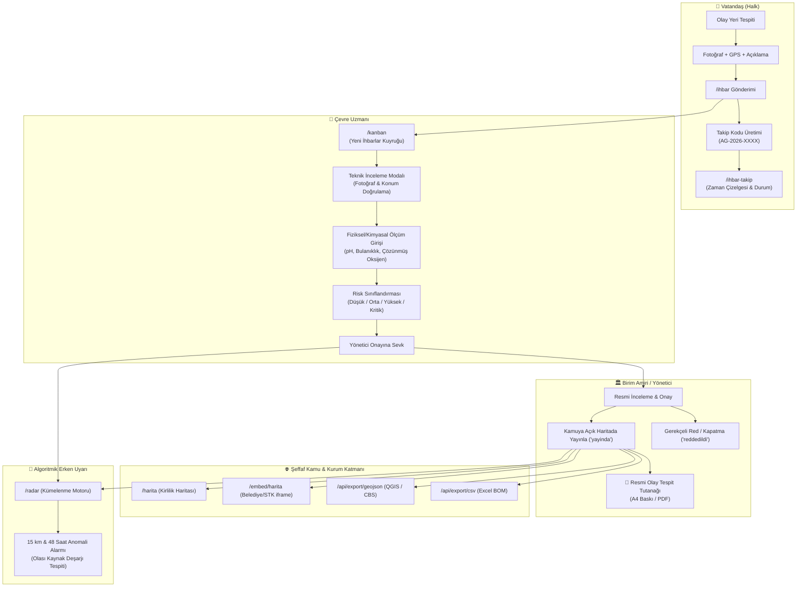

# 🌊 AquaGuard — Akıllı Su Kirliliği İzleme, Erken Uyarı ve Karar Destek Platformu

[](https://nextjs.org/)
[](https://react.dev/)
[](https://www.typescriptlang.org/)
[](https://www.sqlite.org/)
[](https://leafletjs.com/)
[](#test-ve-kalite-denetimi)

**AquaGuard**, su kirliliği olaylarının vatandaş bilimi (Citizen Science) ile yerinde tespit edilmesini, uzmanlar tarafından teknik olarak doğrulanmasını, yöneticiler tarafından resmi müdahale zincirine alınmasını ve kamuya açık şeffaf bir haritada yayınlanmasını sağlayan **uçtan uca bağımsız, yerel çalışan bir çevre karar destek platformudur.**

> 🛡️ **Ürün Odak Sınırı:** AquaGuard, su kirliliği, endüstriyel atık deşarjı, toplu balık ölümleri ve su kalitesi anomali yönetimine odaklanır; hane su tüketimi ya da tasarruf takibi yapmaz.

---

## 🏛️ Mimari ve İş Akışı (Separation of Duties)

AquaGuard, keyfi veri girişlerini ve yetki aşımlarını engellemek için **katı rol tabanlı görevler ayrılığı (RBAC & SoD)** prensibiyle çalışır:



---

## ✨ Temel Yetenekler ve Özellikler

### 1. 📱 Vatandaş Kanıt Zinciri & Şeffaf Takip
* **Mobil Öncelikli İhbar (`/ihbar`):** Oturum açmadan HTML5 Geolocation veya harita üzerinden konum seçerek ihbar gönderme.
* **İhbarcı Gizlilik Seçenekleri:** Tam anonim bildirim; şifreli ve yalnızca yetkili yöneticilere açık gizli iletişim; açık bildirim.
* **Yerel Fotoğraf Depolama:** En fazla 5 MB JPEG/PNG/WebP dosyaları `data/uploads/` altında doğrulanır ve SQLite'da yalnızca metadata tutulur.
* **Benzersiz Takip Kodu:** Yeni ihbarlarda 128-bit rastgele takip kodu oluşturulur; kodu elinde bulunduran kişi `/ihbar-takip` üzerinden süreci görüntüler. Kodu gizli tutun.

### 2. 🧪 Çevre Uzmanı İncelemesi & Saha Ölçümleri
* **Teknik İnceleme Modalı:** Uydu/koordinat haritası, yüksek çözünürlüklü kanıt fotoğrafları ve Zod ile doğrulanmış veri girişi.
* **Fiziksel & Kimyasal Parametreler:** pH, Bulanıklık (NTU), Çözünmüş Oksijen (mg/L), Su Sıcaklığı (°C), İletkenlik ($\mu$S/cm).
* **24 Saatlik SLA Gecikme Uyarısı:** Kritik veya yüksek riskli ihbarlar 24 saat içinde uzman incelemesine alınmazsa panoda yanıp sönen kırmızı alarm tetiklenir.

### 3. 🚨 Coğrafi Kümelenme ve Erken Uyarı Radarı (`/radar`)
* **Deterministik Algoritmik Kümelenme:** Harici bulut kütüphanesine ihtiyaç duymadan, yerel SQLite kayıtları üzerinde Haversine mesafe formülüyle çalışır.
* **Mekansal & Zamansal Kural:** Aynı kategorideki olaylar **15 km yarıçap** ve **48 saatlik zaman penceresi** içinde kümelenir.
* **Alarm Seviyeleri:** 3–4 ilişkili olay "Yüksek Risk"; 5+ olay veya uzman onaylı bir kritik vaka "Kritik Havza Alarmı (Olası Kaynak Deşarjı)" üretir.

### 4. 📄 Resmi Olay Tespit ve Müdahale Tutanağı (A4 / PDF)
* İhbar detayından tek tıkla açılan, `@media print` formatında tanzim edilmiş resmi devlet/kurum tutanağı.
* Takip kodu, tarih/saat, GPS enlem-boylam, kanıt fotoğrafları, uzman saha analizi, yönetici kararı ve **çift yetkili imza/mühür** alanı içerir.

### 5. 🌐 Kurumsal Entegrasyon & Açık Veri (GIS / CBS)
* **Gömülebilir Harita (`/embed/harita`):** Belediyelerin, kaymakamlıkların veya STK'ların kendi web sitelerine tek satır `<iframe>` ile ekleyebileceği, yalnızca doğrulanmış olayları gösteren bağımsız harita.
* **GeoJSON Dışa Aktarımı (`/api/export/geojson`):** RFC 7946 standardında `[boylam, enlem]` koordinatlarıyla QGIS, ArcGIS ve Google Earth uyumlu coğrafi veri seti.
* **Excel Uyumlu CSV (`/api/export/csv`):** Türkçe karakterlerin bozulmasını önleyen UTF-8 BOM ve noktalı virgül (`;`) ayracı.
* **Kişisel Veri Koruması:** Kamuya açık dışa aktarımlarda ihbarcının kimlik/iletişim bilgileri ve kurum içi notlar yer almaz. Gizli iletişim alanı AES-256-GCM ile şifrelenir; anahtar JWT_SECRET'ten türetilir.

### 6. 📴 Saha Ekibi ve Çevrimdışı (Offline-Resilient) Mod (`/saha`)
* İnternetin çekmediği göl, nehir ve kırsal alanlarda çalışan uzmanlar için tablet uyumlu saha arayüzü.
* Görev önbelleği ve saha ölçümleri tarayıcı `localStorage` alanında saklanır; her görev, indirildiği SQLite `version` bilgisini de taşır.
* `/api/saha/sync` kayıtları bağımsız işler ve her mutation için sabit `clientMutationId` ile tekrar gönderimleri SQLite'ta idempotent biçimde yanıtlar. Başarılı kayıtlar cihaz kuyruğundan kaldırılır; başarısız veya çakışan kayıtlar korunur.
* Sunucu sürümü değişmişse ölçümler otomatik yazılmaz. Uzman, saha ve merkez verilerini karşılaştırıp açıkça güncel sürüme uygulama veya sunucu sürümünü kabul ederek vazgeçme kararı verir. Kapatılmış/yönetici kararı verilmiş kayıtlar zorla değiştirilemez; çözüm eylemleri denetim izine eklenir.

### 7. 🔒 Değiştirilemez Denetim İzi (Immutable Audit Trail)
* Durum geçişleri sürükle-bırakla değil, rol kontrollü API işlemleriyle yapılır.
* `report_status_events` tablosunda kimin, ne zaman, hangi gerekçeyle onay verdiği kayıt altına alınır; SQLite trigger'ları bu kayıtların güncellenmesini ve silinmesini engeller.

---

## 👥 Kullanıcı Rolleri ve Yetki Matrisi

| Yetki / Modül | Halk (`halk`) | Çevre Uzmanı (`uzman`) | Yönetici (`yonetici`) | Sistem Yöneticisi (`admin`) |
| :--- | :---: | :---: | :---: | :---: |
| **İhbar Gönderme & Takip** | ✅ | ✅ | ✅ | ✅ |
| **Kirlilik Haritası İzleme** | ✅ (Yalnızca Yayında) | ✅ (Tüm Durumlar) | ✅ (Tüm Durumlar) | ✅ (Tüm Durumlar) |
| **İhbar İnceleme & Ölçüm Girişi** | ❌ | ✅ | ❌ | ✅ |
| **Yayınlama / Kapatma Kararı** | ❌ | ❌ | ✅ | ✅ |
| **Erken Uyarı Radarı (`/radar`)** | ❌ | ✅ | ✅ | ✅ |
| **Saha Modu (`/saha`)** | ❌ | ✅ | ❌ | ✅ |
| **Tüm Veriyi Dışa Aktarma (`?scope=all`)** | ❌ | ✅ | ✅ | ✅ |
| **Kullanıcı & Sistem Yönetimi** | ❌ | ❌ | ❌ | ✅ |

---

## 💻 Teknoloji Yığını

* **Çatı & Arayüz:** Next.js 16 (App Router, Turbopack), React 19, TypeScript
* **Veritabanı:** Yerel SQLite (`better-sqlite3`), WAL modu, append-only audit trigger'ları
* **Stil & Animasyon:** Tailwind CSS v4, Framer Motion
* **Harita & CBS:** Leaflet, React-Leaflet, Supercluster
* **Validasyon & Güvenlik:** Zod, JWT (Jose), bcryptjs, 2FA (TOTP Speakeasy & QRCode)
* **Test Altyapısı:** ESLint, TypeScript Typecheck, Smoke testleri, İş akışı & Kümelenme birim testleri

---

## 🚀 Yerel Kurulum ve Çalıştırma

### Gereksinimler
* **Node.js:** v20 veya üzeri
* **İşletim Sistemi:** Windows (PowerShell), macOS veya Linux

### Adım Adım Kurulum

1. **Bağımlılıkları Yükleyin:**
   ```powershell
   npm ci
   ```

2. **Ortam Değişkenlerini Tanımlayın:**
   ```powershell
   Copy-Item .env.example .env.local
   ```
   `.env.local` dosyasını açıp minimum yapılandırmayı girin:
   ```env
   JWT_SECRET="guclu-en-az-32-karakter-rastgele-anahtar"
   SUPER_ADMIN_EMAIL="admin@aquaguard.local"
   SUPER_ADMIN_PASSWORD="GucluSifre123!"
   SUPER_ADMIN_NAME="Sistem Yöneticisi"
   ```

   *Güvenli bir `JWT_SECRET` üretmek için:*
   ```powershell
   node -e "console.log(require('crypto').randomBytes(48).toString('base64url'))"
   ```

3. **Veritabanını Hazırlayın:**
   ```powershell
   npm run seed:db
   ```
   *Not: Bu komut SQLite şemasını ve ilk süper yönetici hesabını oluşturur; sahte/demo veri eklemez.*

   Eski veritabanlarında base64 fotoğrafları yerel dosyalara taşımak için önce uygulamayı durdurup SQLite dosyasını ve `data/` klasörünü yedekleyin. `.env.local` içindeki JWT_SECRET'i de koruyarak aşağıdaki geçişi çalıştırın:
   ```powershell
   npm run migrate:media
   ```
   Geçiş eski `photos_json` alanını kaldırır; medya dosyaları `data/uploads/` altında, iletişim bilgileri şifreli olarak saklanır. Gizli iletişim verisini okuyabilmek için kullanılan JWT_SECRET aynı kalmalıdır.

   *Hukuki not: Gizli ihbarcı seçenekleri teknik gizlilik kontrolleri sağlar; KVKK, saklama süreleri ve ihbarcı koruma mevzuatına uygunluk için kurumun hukuk/uyum biriminden ayrıca onay alınmalıdır.*

4. **Geliştirme Sunucusunu Başlatın:**
   ```powershell
   npm run dev
   ```
   Tarayıcınızdan `http://localhost:3000` adresine gidin.

---

## 🧪 Test ve Kalite Denetimi

AquaGuard, tüm kritik akışların hatasız çalıştığını doğrulayan entegre bir test paketine sahiptir. Tek komutla tüm denetimleri çalıştırabilirsiniz:

```powershell
npm test
```

| Alt Komut | Denetlenen Alan |
| :--- | :--- |
| `npm run lint` | ESLint kod ve stil standartları |
| `npm run typecheck` | Sıkı TypeScript tip uyumluluğu |
| `npm run smoke` | Kritik dosya ve rota bütünlük kontrolü |
| `npm run test:measurements` | Ölçüm alanları, histerezis ve sınır testleri |
| `npm run test:clustering` | Haversine mesafe motoru, 15 km / 48 saat kümelenme sınırları |
| `npm run test:open-data` | GeoJSON RFC 7946, Excel UTF-8 BOM, anonimleştirme filtreleri |
| `npm run test:workflow` | İhbar yaşam döngüsü, SLA süreleri ve değiştirilemez denetim izi |
| `npm run build` | Next.js tam üretim derlemesi doğrulaması |

---

## 📁 Dizin Yapısı

```text
├── app/
│   ├── api/                 # Rol korumalı API rotaları (auth, radar, export, saha, kanban)
│   ├── embed/harita/        # Belediyeler için iframe gömülebilir bağımsız harita
│   ├── harita/              # Filtrelenebilir kamuya açık kirlilik haritası
│   ├── ihbar/               # Vatandaş kanıt zinciri ihbar bildirim formu
│   ├── ihbar-takip/         # AG-2026-XXXX takip kodu sorgulama sayfası
│   ├── kanban/              # Uzman ve Yönetici doğrulama & onay masası
│   ├── radar/               # Coğrafi anomali ve kümelenme erken uyarı panosu
│   ├── raporlarim/          # Kullanıcıya ait ihbar geçmişi
│   └── saha/                # Çevrimdışı saha ölçüm ve inceleme ekranı
├── components/              # Yeniden kullanılabilir UI, Harita ve Modal bileşenleri
├── data/                    # Yerel SQLite veritabanı ve uploads/ medya dosyaları (Git'e eklenmez)
├── lib/
│   ├── clustering.ts        # Haversine spatio-temporal kümelenme motoru
│   ├── local-db.ts          # better-sqlite3 veritabanı sürücüsü ve şema yöneticisi
│   ├── offline-sync.ts      # Saha çevrimdışı önbellekleme ve senkronizasyon yöneticisi
│   ├── open-data.ts         # GeoJSON ve CSV dönüştürücüleri
│   └── permissions.ts       # Rol bazlı yetkilendirme ve sınır kuralları
└── scripts/                 # Otomatik testler, seed ve veritabanı sıfırlama komutları
```

---

## 📄 Lisans ve Sorumluluk Reddi

Bu yazılım su kalitesi izleme ve karar destek süreçlerini kolaylaştırmak amacıyla geliştirilmiştir. Erken uyarı radarı algoritmik bir tespit mekanizmasıdır; nihai resmi işlem ve yaptırımlar yetkili kamu otoritelerinin fiziki laboratuvar analizleri ve yerinde teftişi neticesinde uygulanmalıdır.
