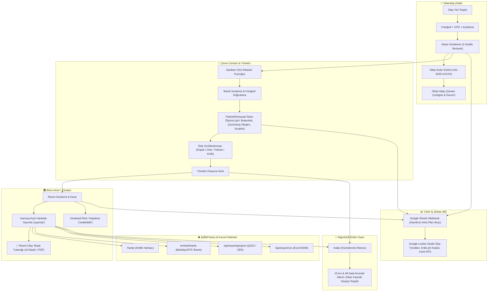

# 🌊 AquaGuard — Akıllı Su Kirliliği İzleme, Erken Uyarı ve Karar Destek Platformu

[](https://nextjs.org/)
[](https://react.dev/)
[](https://www.typescriptlang.org/)
[](https://www.sqlite.org/)
[](https://leafletjs.com/)
[](https://lookerstudio.google.com/)
[](https://github.com/meryemgcl/aquaguard-app/actions/workflows/ci.yml)
[](#-test-ve-kalite-denetimi)

**AquaGuard**, su kirliliği olaylarının vatandaş bilimi (Citizen Science) ile yerinde tespit edilmesini, uzmanlar tarafından teknik ve analitik ölçümlerle doğrulanmasını, yöneticiler tarafından resmi müdahale zincirine alınmasını, canlı iş zekası (BI) panolarına aktarılmasını ve kamuya açık şeffaf bir haritada yayımlanmasını sağlayan **uçtan uca bağımsız, yerel çalışan bir çevre karar destek platformudur.**

> 🛡️ **Ürün Odak Sınırı:** AquaGuard; nehir, göl, kıyı ve su kaynaklarındaki endüstriyel atık deşarjları, toplu balık ölümleri, kimyasal sızıntılar, evsel kirlilik ve su kalitesi anomali yönetimine odaklanır; hane su tüketimi ya da fatura takibi yapmaz.

---

## 🏛️ Mimari ve Görevler Ayrılığı (Separation of Duties)

AquaGuard, keyfi veri girişlerini ve yetki aşımlarını engellemek için **katı rol tabanlı erişim kontrolü (RBAC & SoD)** prensibiyle çalışır:



---

## ✨ Temel Yetenekler ve Yenilikçi Özellikler

### 1. 📱 Vatandaş Kanıt Zinciri & İhbarcı Gizliliği (Whistleblower Protection)
* **Mobil Öncelikli İhbar (`/ihbar`):** HTML5 Geolocation veya harita üzerinden hassas GPS konum seçimiyle ihbar girişi.
* **Üç Kademeli Gizlilik Modeli:**
  1. *Tam Anonim:* İletişim bilgisi sisteme asla kaydedilmez.
  2. *Gizli İletişim:* İletişim bilgisi AES-256-GCM ile şifrelenir; yalnızca yetkili yöneticiler görebilir.
  3. *Açık Bildirim:* Resmi temas ve bilgilendirme için iletişim açık tutulur.
* **128-Bit Benzersiz Takip Kodu:** Her ihbar için `AG-2026-XXXXX` formatında kriptografik takip kodu üretilir; vatandaş süreci `/ihbar-takip` sayfasından canlı izler.

### 2. 🗄️ Güvenli Disk Medya Mimarisi (`data/uploads/`)
* **Veritabanı Şişmesini Önleme:** Görseller SQLite içinde base64 olarak saklanmaz; bağımsız `data/uploads/` dizininde depolanır, veritabanında sadece hash ve metadata tutulur.
* **Çok Katmanlı Güvenlik Denetimi:** Dosyalar yüklenirken magic byte (sihirli bayt) kontrolünden geçirilir, MIME tipi doğrulanır ve path traversal saldırılarına karşı sanitize edilir.
* **Akış Erişimi (`/api/media/[filename]`):** Yetkilendirilmiş ve optimize edilmiş görsel sunumu.

### 3. 🧪 Çevre Uzmanı İncelemesi & Saha Ölçümleri
* **Doğrulama Modalı:** Harita üzerinde nokta konumu, görsel kanıtlar ve laboratuvar ölçüm girişi.
* **Kritik Parametreler:** pH (0–14), Bulanıklık (NTU), Çözünmüş Oksijen (mg/L), Su Sıcaklığı (°C), İletkenlik ($\mu$S/cm).
* **24 Saatlik SLA Gecikme Radarı:** Kritik veya yüksek riskli ihbarlar 24 saat içinde uzman incelemesine alınmazsa panoda yanıp sönen kırmızı SLA alarmı tetiklenir.

### 4. 📊 Google Sheets & Looker Studio Canlı Entegrasyonu
* **Sıfır Veri Kaybı & Canlı Veri Akışı:** Her ihbar girişi, uzman ölçümü ve yönetici onayı arka planda Google Sheets Webhook'una asenkron (`void fetch`) olarak iletilir; istemciyi asla bekletmez.
* **Looker Studio Entegrasyonu:** Google E-Tablo veri kaynağı olarak bağlanarak Balıkesir/Güney Marmara ve ulusal ölçekte ilçe bazlı kirlilik dağılımı, haftalık risk trendleri ve kritik asidik anomaliler (pH < 6.5) canlı izlenebilir.

### 5. 📴 Saha Ekibi Çevrimdışı Modu & Çakışma Yönetimi (`/saha`)
* **Offline-Resilient Mimari:** İnternetin olmadığı göl ve akarsu havzalarında tablet üzerinden kesintisiz görev alma ve ölçüm kaydetme.
* **İdempotent Senkronizasyon:** `clientMutationId` ve `sync_mutations` tablosu ile mükerrer istekler güvenle engellenir.
* **İyimser Kilitleme (Optimistic Concurrency):** `version` sütunu kontrolüyle, sahadayken merkezde güncellenen kayıtlar ezilmez; uzman çakışma karşılaştırma modalı ile seçim yapar.

### 6. 🚨 Mekansal-Zamansal Kümelenme ve Erken Uyarı Radarı (`/radar`)
* **Haversine Algoritması:** Dış bulut servisi gerektirmeksizin yerel SQLite kayıtları üzerinde çalışan kümelenme motoru.
* **Kural:** Aynı kategorideki olaylar **15 km yarıçap** ve **48 saatlik pencerede** birleştiğinde anomali tespit edilir. 3–4 olayda "Yüksek Risk", 5+ olayda veya uzman onaylı kritik vakada "Kritik Havza Alarmı (Olası Kaynak Deşarjı)" üretilir.

### 7. 📄 Resmi Olay Tespit ve Müdahale Tutanağı (A4 / PDF)
* İhbar detayından tek tıkla yazdırılabilen, `@media print` formatında tanzim edilmiş resmi teftiş tutanağı.
* Takip numarası, koordinatlar, saha parametreleri, yönetici kararı ve çift yetkili imza/mühür bloğu içerir.

### 8. 🌐 Kurumsal Entegrasyon & Açık Veri Standartları (CBS / GIS)
* **Gömülebilir Harita (`/embed/harita`):** Belediye ve STK web sitelerine `<iframe>` ile eklenebilen izole harita.
* **GeoJSON Standardı (`/api/export/geojson`):** RFC 7946 uyumlu `[boylam, enlem]` koordinatlarıyla QGIS, ArcGIS ve Google Earth entegrasyonu.
* **Excel Uyumlu CSV (`/api/export/csv`):** Türkçe karakterlerin bozulmasını önleyen UTF-8 BOM ve `;` ayracı.

### 9. 🔒 Değiştirilemez Denetim İzi (Immutable Audit Trail)
* Durum değişiklikleri sürükle-bırakla değil, rol kontrollü API işlemleriyle yapılır.
* `report_status_events` tablosunda kimin, ne zaman, hangi işlemle onay verdiği kayıt altına alınır; SQLite trigger'ları bu kayıtların güncellenmesini veya silinmesini engeller.

---

## 👥 Kullanıcı Rolleri ve Yetki Matrisi

AquaGuard sisteminde 4 temel rol tanımlıdır:

| Yetki / Modül | Halk (`halk`) | Çevre Uzmanı (`uzman`) | Yönetici (`yonetici`) | Sistem Yöneticisi (`super_admin` / `admin`) |
| :--- | :---: | :---: | :---: | :---: |
| **İhbar Gönderme & Takip** | ✅ | ✅ | ✅ | ✅ |
| **Kirlilik Haritası İzleme** | ✅ (Yalnızca Yayında) | ✅ (Tüm Durumlar) | ✅ (Tüm Durumlar) | ✅ (Tüm Durumlar) |
| **İhbar İnceleme & Ölçüm Girişi** | ❌ | ✅ | ❌ | ✅ |
| **Yönetici Onayı / Yayımlama** | ❌ | ❌ | ✅ | ✅ |
| **Erken Uyarı Radarı (`/radar`)** | ❌ | ✅ | ✅ | ✅ |
| **Çevrimdışı Saha Modu (`/saha`)** | ❌ | ✅ | ❌ | ✅ |
| **CBS / GeoJSON / CSV Dışa Aktarım** | ✅ (Yayında Olanlar) | ✅ (Tüm Veri) | ✅ (Tüm Veri) | ✅ (Tüm Veri) |
| **Kullanıcı & Sistem Yönetimi** | ❌ | ❌ | ❌ | ✅ |

*Tüm varsayılan yerel hesap şifresi:* `AquaGuard123!`

---

## 💻 Teknoloji Yığını

* **Frontend:** Next.js 16 (App Router, Turbopack), React 19, TypeScript 5
* **Veritabanı:** Yerel SQLite (`better-sqlite3`), WAL modu, append-only audit trigger'ları
* **Stil & Tasarım:** Modern CSS Modules, Dark Glassmorphism, CSS Print Styles
* **Harita & CBS:** Leaflet, React-Leaflet, Supercluster (CBS uyumlu kümelenme)
* **Güvenlik & Doğrulama:** Zod, JWT (Jose), bcryptjs, AES-256-GCM şifreleme, 2FA (TOTP)
* **İş Zekası (BI):** Google Apps Script Webhook, Google Sheets, Google Looker Studio
* **Test Altyapısı:** ESLint, TypeScript Typecheck, Smoke Checks, Tsx Test Suites

---

## 🚀 Yerel Kurulum ve Çalıştırma

### Gereksinimler
* **Node.js:** v20 veya üzeri
* **İşletim Sistemi:** Windows (PowerShell), macOS veya Linux

### Adım Adım Kurulum

1. **Bağımlılıkları Yükleyin:**
   ```powershell
   npm ci
   ```

2. **Ortam Değişkenlerini Tanımlayın:**
   ```powershell
   Copy-Item .env.example .env.local
   ```
   `.env.local` dosyasını açıp minimum yapılandırmayı girin:
   ```env
   JWT_SECRET="guclu-en-az-32-karakter-rastgele-anahtar"
   SUPER_ADMIN_EMAIL="meriguclu123@gmail.com"
   SUPER_ADMIN_PASSWORD="AquaGuard123!"
   SUPER_ADMIN_NAME="Sistem Yöneticisi"
   GOOGLE_SHEETS_WEBHOOK_URL="https://script.google.com/macros/s/.../exec"
   ```

   *Güvenli bir `JWT_SECRET` üretmek için:*
   ```powershell
   node -e "console.log(require('crypto').randomBytes(48).toString('base64url'))"
   ```

3. **Veritabanını Başlatın:**
   ```powershell
   npm run seed:db
   ```

4. **Geliştirme Sunucusunu Başlatın:**
   ```powershell
   npm run dev
   ```
   Tarayıcınızdan `http://localhost:3000` adresine gidin.

---

## 📈 Google Sheets & Looker Studio Bağlantısı

1. **Google E-Tablo:** [Google Sheets](https://sheets.google.com) üzerinde `AquaGuard_Canli_Veri_Havuzu` adıyla yeni bir tablo oluşturun. İlk satıra başlıkları ekleyin:
   `Takip Kodu | Tarih / Saat | İl | İlçe | Kategori | Risk Seviyesi | Durum | İhbar Açıklaması | Su Kaynağı | pH Değeri | Çözünmüş Oksijen | Bulanıklık | Uzman Notu | Gizlilik Düzeyi`
2. **Apps Script:** `Uzantılar` → `Apps Script` açıp webhook kodunu yapıştırın, Web Uygulaması olarak "Herkes" erişimiyle dağıtın.
3. **URL Ekleme:** Elde edilen Web App URL'sini `.env.local` dosyasına `GOOGLE_SHEETS_WEBHOOK_URL` olarak kaydedin.
4. **Looker Studio:** [Google Looker Studio](https://lookerstudio.google.com) üzerinden bu Google E-Tabloyu seçerek anlık grafiklerinizi oluşturun.

---

## 🧪 Test ve Kalite Denetimi

AquaGuard, tüm kritik akışların hatasız çalıştığını garanti eden entegre test paketine sahiptir. Tek komutla tüm denetimleri çalıştırabilirsiniz:

```powershell
npm test
```

| Komut | Kapsanan Denetim Alanı |
| :--- | :--- |
| `npm run lint` | ESLint kod kalitesi ve stil standartları |
| `npm run typecheck` | Sıkı TypeScript tip denetimi (`tsc --noEmit`) |
| `npm run smoke` | Kritik dosya, rota ve bileşen bütünlük kontrolü |
| `npm run test:measurements` | Ölçüm alanları, histerezis, debounce ve sınır testleri |
| `npm run test:clustering` | Haversine mesafe algoritması, 15 km / 48 saat anomali sınırları |
| `npm run test:open-data` | GeoJSON RFC 7946, Excel UTF-8 BOM ve anonimleştirme filtreleri |
| `npm run test:workflow` | İhbar yaşam döngüsü, SLA süreleri ve değiştirilemez denetim izi |
| `npm run test:media` | Disk medya yazma, streaming okuma, path traversal ve gizlilik testleri |
| `npm run build` | Next.js tam üretim derlemesi (33 statik ve dinamik rota doğrulaması) |

---

## 📁 Dizin Yapısı

```text
├── app/
│   ├── api/                 # Rol korumalı API rotaları (auth, radar, export, saha, kanban, media)
│   ├── embed/harita/        # Belediyeler için iframe gömülebilir bağımsız harita
│   ├── harita/              # Filtrelenebilir kamuya açık kirlilik haritası
│   ├── ihbar/               # Vatandaş kanıt zinciri ihbar bildirim formu
│   ├── ihbar-takip/         # AG-2026-XXXXX takip kodu sorgulama sayfası
│   ├── kanban/              # Uzman ve Yönetici doğrulama & onay masası
│   ├── radar/               # Coğrafi anomali ve kümelenme erken uyarı panosu
│   ├── raporlarim/          # Kullanıcıya ait ihbar geçmişi
│   └── saha/                # Çevrimdışı saha ölçüm ve inceleme ekranı
├── components/              # Yeniden kullanılabilir UI, Harita, Modal bileşenleri
├── data/                    # Yerel SQLite veritabanı ve uploads/ medya deposu (Git'e eklenmez)
├── lib/
│   ├── clustering.ts        # Haversine spatio-temporal kümelenme motoru
│   ├── google-sheets-sync.ts# Canlı Google Sheets & Looker Studio senkronizasyon servisi
│   ├── local-db.ts          # better-sqlite3 veritabanı sürücüsü ve şema yöneticisi
│   ├── media-storage.ts     # Disk tabanlı güvenli medya depolama ve magic-byte denetimi
│   ├── offline-sync.ts      # Saha çevrimdışı önbellekleme ve senkronizasyon yöneticisi
│   ├── open-data.ts         # GeoJSON ve CSV dönüştürücüleri
│   ├── permissions.ts       # Rol bazlı yetkilendirme ve sınır kuralları
│   └── reporter-contact.ts  # AES-256-GCM ihbarcı iletişim verisi şifreleme servisi
└── scripts/                 # Otomatik testler, seed ve veritabanı sıfırlama komutları
```

---

## 📄 Lisans ve Sorumluluk Reddi

Bu yazılım su kalitesi izleme ve karar destek süreçlerini kolaylaştırmak amacıyla geliştirilmiştir. Erken uyarı radarı ve AI önerileri karar destek mekanizmalarıdır; nihai resmi işlem ve yaptırımlar yetkili kamu otoritelerinin fiziki laboratuvar analizleri ve yerinde teftişi neticesinde uygulanmalıdır.
